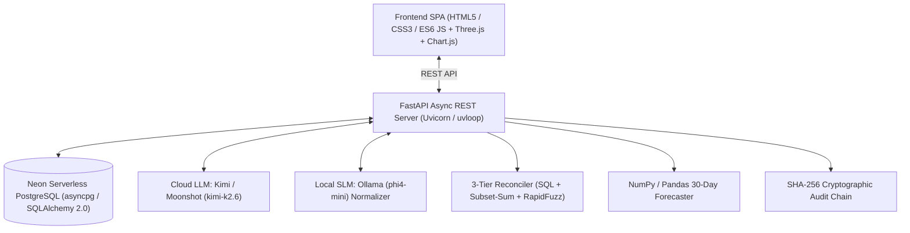

# ⚡ LedgerIQ — Autonomous AI Finance Controller

> **Razorpay Buildathon — Track 04: AI Finance Controller**  
> *Run the books and the cash position: An autonomous finance-ops agent that closes multi-source reconciliation loops across Bank feeds, Razorpay gateway settlements, and ERP invoices with real-time AI root-cause diagnostics, forward cash stress simulations, and cryptographic auditability.*

---

## 📌 Problem Statement & Why Now

In enterprise finance operations, **verification capacity—not generation speed—is the true operational bottleneck**. 

Finance teams manually cross-check bank statement line items against payment gateway payouts and ERP invoices, chasing down 2% fee variances, settlement timing cutoffs, and dirty merchant typos. Unmatched anomalies sit unresolved in suspense accounts, blinding CFOs to their true 30-day forward cash runway.

**LedgerIQ** automates this entire loop:
1. **Ingests & Normalizes** dirty multi-source feeds concurrently.
2. **Executes a 3-Tier Cascade Reconciler** (Exact SQL $\rightarrow$ Subset-Sum Combinatorial $\rightarrow$ RapidFuzz Semantic).
3. **Deploys LLM Agents** to diagnose the exact root cause of exceptions and propose automated remediation entries.
4. **Simulates 30-Day Forward Cash Runway** under real-time liquidity stress scenarios.
5. **Cryptographically Chains Every State Change** into an immutable SHA-256 audit ledger.

---

## 🛠️ Complete Tech Stack



### 1. Backend Core & API
* **FastAPI (`v0.141`)**: High-throughput async REST API framework with native OpenAPI/Swagger generation.
* **Uvicorn (`v0.52`) & uvloop (`v0.22`)**: ASGI production server with ultra-fast asynchronous event loops.
* **Pydantic (`v2.13`) & Pydantic-Settings**: Strict payload validation, data schemas, and environment configuration.
* **Python 3.12+ (Asyncio / AnyIO)**: Fully non-blocking concurrency across database queries and LLM API calls.

### 2. Database & Data Layer
* **Neon Serverless PostgreSQL**: Cloud relational database hosting raw financial records, reconciliation batches, exception states, and audit trails.
* **SQLAlchemy 2.0 (Async)**: Declarative modern ORM for schema modeling and transactional integrity.
* **asyncpg (`v0.31`)**: Native C-speed PostgreSQL asynchronous driver.
* **PostgreSQL Extensions**:
  * `uuid-ossp`: Collision-resistant UUID generation for distributed record tracking.
  * `pg_trgm`: Database-level trigram indexing for similarity and string indexing.

### 3. Artificial Intelligence & LLMs
* **Cloud LLM — Kimi / Moonshot (`kimi-k2-0711-preview`)**:
  * **AI Root-Cause Diagnostics**: Ingests raw JSON transaction payloads from Bank, Gateway, and ERP to produce human-readable explanations of fee deductions, timing delays, and pricing variances.
  * **LedgerIQ Copilot**: Interactive financial assistant answering natural language questions grounded in active batch metrics.
  * **Actionable Remediation**: Suggests automated general-ledger adjustment entries.
* **Local SLM — Ollama (`phi4-mini:latest`)**:
  * Concurrent merchant entity name normalization (strips OCR noise, standardizes vendor entity names) with graceful regex fallback.
* **HTTPX (`v0.28`)**: Async HTTP client for streaming requests to cloud and local inference servers.

### 4. Financial Algorithms & Simulation Engine
* **3-Tier Cascade Reconciler**:
  * **Tier 1 (Exact SQL Match)**: Direct indexed match on reference codes, amounts, and dates ($\pm 1$ day) with confidence `1.00`.
  * **Tier 2 (Subset-Sum Aggregator)**: Dynamic programming algorithm solving 1-to-many lump payout settlements ($1 \text{ lump deposit} = \sum N \text{ invoices} - 2\% \text{ gateway fee}$) with confidence `0.92`.
  * **Tier 3 (RapidFuzz Composite Match)**: High-speed C++ token-sort fuzzy semantic matching across merchant aliases and dirty ERP strings ($C \ge 0.75$).
* **NumPy (`v2.4`) & Pandas (`v3.0`)**: 30-day cash flow projections, moving averages, and dynamic liquidity stress simulations.
* **Faker (`v40.37`)**: Synthetic financial batch generator modeling authentic Indian enterprise accounting feeds (`en_IN`).

### 5. Frontend & Data Visualization
* **Modern Vanilla SPA (HTML5, CSS3, ES6 JavaScript)**:
  * Zero-build-tool overhead for instant load speeds and clean separation of concerns.
  * Custom design system with glassmorphism (`backdrop-filter`), responsive layout, and reactive **Dark / Light mode switching**.
* **Three.js (`r128`) WebGL**:
  * Interactive 3D particle network representing live multi-source financial nodes and data streaming loops.
* **Chart.js**:
  * Dual-curve 30-day forward cash flow chart comparing baseline runway against simulated stress testing.

### 6. Cryptography & Compliance
* **SHA-256 Event Chaining**: Every state modification (ingestion, match, AI diagnosis, human resolution) generates an immutable event where $\text{event\_hash} = \text{SHA-256}(\text{prev\_hash} + \text{payload})$.
* **Audit Exporter**: Instant downloadable audit evidence in CSV and JSON formats.

---

## 📁 Repository Structure

```
ai_finance_controller/
├── backend/
│   ├── app/
│   │   ├── api/                 # REST endpoints (health, batch, recon, exceptions, forecast, audit, copilot)
│   │   ├── core/                # App settings and environment loading
│   │   ├── db/                  # SQLAlchemy models and Neon database connection
│   │   ├── schemas/             # Pydantic request/response schemas
│   │   └── services/            # Business logic (reconciler, normalizer, diagnostics, forecaster, copilot)
│   ├── scripts/
│   │   ├── init_db.py           # Database tables initialization script
│   │   └── benchmark_e2e.py     # Automated judging benchmark script
│   ├── run.py                   # Backend entrypoint (uvicorn launcher)
│   ├── requirements.txt         # Python dependencies
│   └── .env                     # Database and API credentials
├── frontend/
│   ├── css/
│   │   └── style.css            # Custom glassmorphism design system & animations
│   ├── js/
│   │   ├── app.js               # Frontend controller, API client, and SPA navigation
│   │   └── three-bg.js          # Three.js 3D WebGL particle network
│   ├── index.html               # Main SPA HTML file
│   └── how_to_implement_animation.md
├── demo.md                      # Complete step-by-step presentation & demo guide
├── running project.md           # Operational guide to run backend and frontend
├── project.md                   # Hackathon Track specifications
└── README.md                    # Project documentation
```

---

## 🚀 Getting Started

### Prerequisites
* Python 3.12+
* Access to a PostgreSQL database (e.g., [Neon](https://neon.tech/))
* (Optional) Moonshot/Kimi API key for cloud LLM reasoning
* (Optional) Ollama installed locally for offline entity normalization

---

### Step 1: Clone & Configure Backend

```bash
cd backend
python3 -m venv .venv
source .venv/bin/activate
pip install -r requirements.txt
```

Create or verify `backend/.env`:
```env
# Neon Serverless PostgreSQL Database Connection
DATABASE_URL=postgresql+asyncpg://<user>:<password>@<neon-host>/<dbname>?ssl=require

# Cloud LLM Configuration (Moonshot / Kimi API)
KIMI_API_KEY=your-kimi-api-key-here
KIMI_BASE_URL=https://api.moonshot.cn/v1
KIMI_MODEL=kimi-k2-0711-preview

# Optional: Local Ollama Model
OLLAMA_BASE_URL=http://localhost:11434
OLLAMA_MODEL=phi4-mini:latest
```

---

### Step 2: Initialize Database

Create database tables and required extensions (`uuid-ossp`, `pg_trgm`):
```bash
python scripts/init_db.py
```

---

### Step 3: Start the Backend Server

```bash
python run.py
```
* Backend will be running at: **`http://localhost:8000`**
* Interactive Swagger Docs: **`http://localhost:8000/docs`**
* Health Check: **`http://localhost:8000/health`**

> **Windows note:** The event-loop policy (`WindowsSelectorEventLoopPolicy`) is set automatically in `backend/run.py` and `backend/app/main.py` to avoid asyncpg SSL/Proactor noise on shutdown/reload — no manual `PYTHONPATH` or env tweak needed.

---

### Step 4: Start the Frontend Client

Open a second terminal window from the project root:

```bash
cd frontend
python3 -m http.server 3000
```
* Open your browser at: **`http://localhost:3000`**

---

## 🧪 Automated E2E Benchmark

To execute the automated benchmark evaluating throughput, match rate %, risk breakdown, and audit verification:

```bash
cd backend
source .venv/bin/activate
python scripts/benchmark_e2e.py
```

**Expected distribution** (generated with `python -m app.services.synthetic_generator`):
- **20 BANK** records, **10 GATEWAY**, **35 INVOICE** (65 total)
- Match breakdown after reconciliation:
  - **Tier 1 (Exact):** 10 bank–invoice pairs (confidence 1.00)
  - **Tier 2 (One-to-Many):** 5 gateway lump settlements vs 15 invoices (subset-sum, confidence 0.92)
  - **Tier 3 (Fuzzy):** 5 bank–invoice pairs with dirty names/missing refs (RapidFuzz composite ≥ 0.75, enabled by weight redistribution fix)
  - **Exception:** 15 unmatched records requiring AI diagnosis

The bench script (`scripts/benchmark_e2e.py`) will regenerate a fresh batch, run the 3-tier cascade, risk triage, AI diagnostics, and 30-day runway forecast, then output match accuracy, tier counts, and audit-entry verification.

---

## 🎬 Demonstrating LedgerIQ

Follow the full interactive demo walkthrough documented in **[`demo.md`](file:///Users/abhi/Documents/Projects/ai_finance_controller/demo.md)**:

1. **3D Hero & Architecture Modal**: Interactive WebGL particle graph & 5-stage architecture overview.
2. **Multi-Source Ingestion**: Generate realistic synthetic batches across Bank, Razorpay settlements, and ERP invoices.
3. **3-Tier Cascade Reconciler**: Exact SQL, Subset-Sum Lump matching, and RapidFuzz semantic scoring.
4. **AI Exception Diagnostics**: LLM explanations of fee variances, timing cutoffs, and proposed G/L adjustments.
5. **Human-in-the-Loop Resolution**: Accept, manually adjust, or reject anomalies.
6. **Forward Cash Stress Forecaster**: What-If scenario simulations for payout delays, refund surges, and expense shifts.
7. **Tamper-Evident SHA-256 Audit Trail**: Inspect cryptographic blocks and export audit reports.
8. **Conversational Copilot**: Context-aware Q&A on active financial batch metrics.

9. **Agentic Orchestrator**: Run `POST /api/agent/orchestrate/{batch_id}` to execute reconcile → diagnose → forecast in one call (new in this release).

---

## 📄 License
Built for the **Razorpay Buildathon 2026** — Track 04 (AI Finance Controller).
Distributed under the MIT License.
